# Navigation Flow

_As of: 2026-10-28._

This document maps the site navigation flow for each actor in the MMCA.ADC application. Each mermaid diagram shows the pages accessible to that actor and the directional navigation links between them.

## Actors

| Actor | Access Level | Identification |
|---|---|---|
| **Anonymous** | Public conference pages only | Not authenticated |
| **Attendee** | Public + profile + feedback + bookmarks | Authenticated, default `Attendee` role |
| **Speaker** | Attendee + speaker dashboard, speaker QR credential, live-session moderation and presenter view | Authenticated, account linked to a Speaker (`speaker_id` claim) |
| **ContentEditor** | Attendee + catalog curation (sessions, speakers, categories, sponsors, partners, activities), a strict subset of the Organizer's capabilities, plus privileged reads on the public conference pages (unpublished events included) | Authenticated, `ContentEditor` role |
| **Organizer** | Full access: conference CRUD, user management, role administration, push notifications, badge check-in and points overview, feedback analytics, session selection | Authenticated, `Organizer` role |

> **Roles & menu:** the role vocabulary is `Organizer`, `ContentEditor` and `Attendee` (the default, `RoleNames`). `Organizer` holds every capability; `ContentEditor` holds the catalog-curation subset and no event-structure, room, question, session-selection or user-administration rights; the role-to-capability map itself is editable on the Role Administration pages. A *Speaker* is an attendee whose account is linked to a Speaker, surfaced via the `speaker_id` claim. The left nav is data-driven from each module's `IUIModule.NavItems` (ADC's three modules, the MAUI head's `DeviceUIModule` and the framework's `NotificationUIModule`): items carry a required role (`Organizer`), claim (`speaker_id`) or permission (`notifications:manage`, on the framework's Push Notifications entry) and are hidden when the user lacks it. See **Authorization Model** at the end.

---

## 1. Anonymous User

Pages accessible without authentication: home, login, register, the social sign-in completion page, the two password-reset pages, the email-confirmation landing, and all public conference pages. For an anonymous visitor (and for an attendee) `/conference/events` is a pass-through: it redirects to the current or next event's detail page instead of listing past editions, so that detail page carries no Back button.

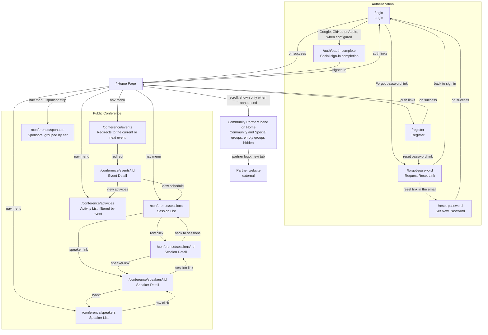

---

## 2. Attendee (Authenticated User)

Inherits all anonymous pages. Gains access to profile, feedback submission, session bookmarking, the conference-day live layer, points and the notification inbox. Unauthenticated visitors are redirected to login. `/my-badge` has no nav item for an attendee (the "My Badge" entry is Organizer-only); the page itself carries a plain `[Authorize]`, so a typed or bookmarked URL still opens it.

```mermaid
flowchart TD
    subgraph Auth["Authentication"]
        Login["/login<br/>Login"]
        Register["/register<br/>Register"]
    end

    subgraph Profile["Identity / Profile"]
        MyProfile["/profile<br/>My Profile"]
        Claims["/profile/claims<br/>User Claims"]
        Devices["/profile/sessions<br/>Signed-in devices, framework page"]
        Inbox["/notifications/inbox<br/>Notification Inbox, framework page"]
    end

    subgraph Public["Public Conference"]
        PubEvents["/conference/events<br/>Redirects to the current or next event"]
        PubEventDetail["/conference/events/:Id<br/>Event Detail"]
        PubSessions["/conference/sessions<br/>Session List"]
        PubSessionDetail["/conference/sessions/:Id<br/>Session Detail"]
        PubSpeakers["/conference/speakers<br/>Speaker List"]
        PubSpeakerDetail["/conference/speakers/:Id<br/>Speaker Detail"]
        PubSponsors["/conference/sponsors<br/>Sponsors, grouped by tier"]
        PubActivities["/conference/activities<br/>Activity List, filtered by event"]
    end

    subgraph Engagement["Engagement / Feedback"]
        EventFeedback["/feedback/event/:EventId<br/>Event Feedback"]
        SessionFeedback["/feedback/session/:SessionId<br/>Session Feedback"]
    end

    subgraph Live["Conference-Day Live Layer"]
        HappeningNow["/happening-now<br/>Happening Now"]
        SessionLive["/conference/sessions/:Id/live<br/>Live Session (Q and A, polls)"]
    end

    subgraph Badge["Badge and Rewards"]
        MyBadge["/my-badge<br/>My Badge, QR credential"]
        MyPoints["/points<br/>My Points, leaderboard opt-in"]
    end

    subgraph QrLanding["Scanned QR Landings, no nav item"]
        SponsorVisit["/engage/sponsors/:SponsorId<br/>Sponsor Visit recorded"]
        RoomCheckIn["/engage/rooms/:RoomId<br/>Room Check-In recorded"]
    end

    Home["/  Home Page"]

    Home -->|nav menu| PubEvents
    Home -->|nav menu| PubSessions
    Home -->|nav menu| PubSpeakers
    Home -->|nav menu| PubSponsors
    Home -->|nav menu| PubActivities
    Home -->|nav menu, My Account| MyProfile
    Home -->|nav menu, My Account| HappeningNow
    Home -->|nav menu, My Account| MyPoints
    Home -->|nav menu, My Account| Inbox
    Home -->|hero button, while the event is live| HappeningNow
    Home -.->|typed URL, no nav item| MyBadge

    HappeningNow -->|session title| PubSessionDetail
    HappeningNow -->|join a running session| SessionLive
    HappeningNow -->|view announcements| Inbox
    PubSessionDetail -->|Live, inside the live window| SessionLive
    SessionLive -->|breadcrumb| HappeningNow

    PrintedQr["Printed QR code<br/>sponsor booth sign or session-room door"]
    PrintedQr -.->|scan, deep link only| SponsorVisit
    PrintedQr -.->|scan, deep link only| RoomCheckIn
    SponsorVisit -->|back to sponsors| PubSponsors

    Login -->|on success| Home
    Register -->|on success| Home
    Home -->|Logout, nav menu or app bar| Login
    MyProfile -->|manage devices| Devices
    MyProfile -->|delete account| Home
    Claims -->|back to profile| MyProfile

    PubEvents -->|redirect| PubEventDetail
    PubEventDetail -->|view schedule| PubSessions
    PubEventDetail -->|view activities| PubActivities
    PubEventDetail -->|submit feedback| EventFeedback

    PubSessions -->|row click| PubSessionDetail
    PubSessionDetail -->|back to sessions| PubSessions
    PubSessionDetail -->|speaker link| PubSpeakerDetail
    PubSessionDetail -->|submit feedback| SessionFeedback

    PubSpeakers -->|row click| PubSpeakerDetail
    PubSpeakerDetail -->|session link| PubSessionDetail
    PubSpeakerDetail -->|back| PubSpeakers

    EventFeedback -->|cancel| PubEventDetail
    SessionFeedback -->|cancel| PubSessionDetail
```

---

## 3. Speaker

Inherits all attendee pages. Gains access to the speaker dashboard for managing their own profile, viewing assigned sessions, preparing live polls and reviewing feedback ratings, plus the speaker QR credential. The presenter view is reached from the live session page, whose Present button renders for a linked speaker or an Organizer.

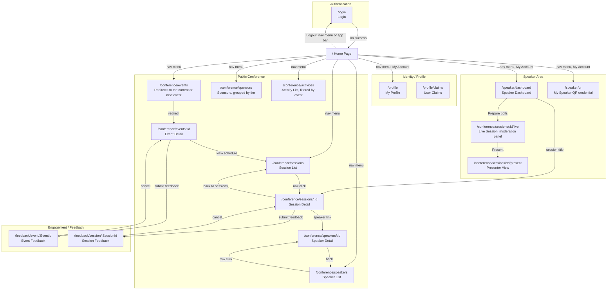

---

## 4. Organizer

Authenticated users with the `Organizer` role. Inherits all attendee and public pages. Adds CRUD management for every conference entity (events, sessions, speakers, categories, questions, rooms, sponsors, partners, activities), user management, **role administration** (the per-role permission editor), feedback analytics, the badge **check-in** and attendance pages, the points overview, push notifications, and the AI-assisted **Session Selection Dashboard**. The conference management items sit in the nav menu's *Admin* section (labelled "Administration") inside the collapsible "Conference" group; "Users" and "Roles" sit directly in that section and the framework's "Push Notifications" entry sits in its "Notifications" group; "My Badge", "Check In", "Attendance" and "Points Overview" sit in the general section, each gated on the `Organizer` role. As a privileged reader the Organizer also gets the full public event grid, unpublished events included, instead of the redirect to the current event.

```mermaid
flowchart TD
    subgraph Auth["Authentication"]
        Login["/login<br/>Login"]
    end

    subgraph Profile["Identity"]
        MyProfile["/profile<br/>My Profile"]
        Users["/users<br/>User Management"]
        UserDetail["/users/:Id<br/>User Detail"]
        Roles["/roles<br/>Role Administration"]
        RoleEdit["/roles/:Role<br/>Role Permission Editor"]
    end

    subgraph Notifications["Framework: Push Notifications"]
        PushList["/notifications<br/>Push Notifications"]
        PushSend["/notifications/send<br/>Send Notification"]
    end

    subgraph Public["Public Conference"]
        PubEvents["/conference/events<br/>Public Event List"]
        PubEventDetail["/conference/events/:Id<br/>Public Event Detail"]
        PubSessions["/conference/sessions<br/>Public Session List"]
        PubSessionDetail["/conference/sessions/:Id<br/>Public Session Detail"]
        PubSpeakers["/conference/speakers<br/>Public Speaker List"]
        PubSpeakerDetail["/conference/speakers/:Id<br/>Public Speaker Detail"]
        PubSponsors["/conference/sponsors<br/>Public Sponsors, grouped by tier"]
        PubActivities["/conference/activities<br/>Public Activity List"]
    end

    subgraph Engagement["Engagement / Feedback"]
        EventFeedback["/feedback/event/:EventId<br/>Submit Event Feedback"]
        SessionFeedback["/feedback/session/:SessionId<br/>Submit Session Feedback"]
    end

    subgraph EventMgmt["Organizer: Event Management"]
        EventList["/events<br/>Event List"]
        EventCreate["/events/create<br/>Create Event"]
        EventDetail["/events/:Id<br/>Edit Event"]
        AdminEventFB["/events/:EventId/feedback<br/>Event Feedback Analytics"]
    end

    subgraph SessionMgmt["Organizer: Session Management"]
        SessionList["/sessions<br/>Session List"]
        SessionCreate["/sessions/create<br/>Create Session"]
        SessionDetail["/sessions/:Id<br/>Edit Session"]
        AdminSessionFB["/sessions/:SessionId/feedback<br/>Session Feedback Analytics"]
    end

    subgraph SpeakerMgmt["Organizer: Speaker Management"]
        SpeakerList["/speakers<br/>Speaker List"]
        SpeakerCreate["/speakers/create<br/>Create Speaker"]
        SpeakerDetail["/speakers/:Id<br/>Edit Speaker"]
    end

    subgraph RefData["Organizer: Reference Data"]
        CatList["/conferencecategories<br/>Category List"]
        CatCreate["/conferencecategories/create<br/>Create Category"]
        CatDetail["/conferencecategories/:Id<br/>Edit Category"]
        QuestionList["/questions<br/>Question List"]
        QuestionCreate["/questions/create<br/>Create Question"]
        QuestionDetail["/questions/:Id<br/>Edit Question"]
        RoomList["/rooms<br/>Room List"]
        RoomCreate["/rooms/create<br/>Create Room"]
        RoomDetail["/rooms/:Id<br/>Edit Room"]
    end

    subgraph SponsorMgmt["Organizer: Sponsor Management"]
        SponsorList["/sponsors<br/>Sponsor List"]
        SponsorCreate["/sponsors/create<br/>Create Sponsor"]
        SponsorDetail["/sponsors/:Id<br/>Edit Sponsor"]
    end

    subgraph PartnerMgmt["Organizer: Partner Management"]
        PartnerList["/partners<br/>Partner List"]
        PartnerCreate["/partners/create<br/>Create Partner"]
        PartnerDetail["/partners/:Id<br/>Edit Partner"]
    end

    subgraph ActivityMgmt["Organizer: Activity Management"]
        ActivityList["/activities<br/>Activity List"]
        ActivityCreate["/activities/create<br/>Create Activity"]
        ActivityDetail["/activities/:Id<br/>Edit Activity"]
    end

    subgraph CheckIn["Organizer: Check-In and Rewards"]
        MyBadge["/my-badge<br/>My Badge, QR credential"]
        Scan["/check-in<br/>Scan Badges<br/>camera on MAUI, search on web"]
        Attendance["/organizer/attendance<br/>Attendance Overview"]
        PointsOverview["/organizer/points<br/>Points Overview"]
    end

    subgraph Decision["Organizer: Session Selection"]
        SessionSelection["/sessions/selection-dashboard<br/>Session Selection Dashboard<br/>status mix, AI scoring"]
    end

    Home["/  Home Page"]

    %% Top-level navigation
    Home -->|nav menu| PubEvents
    Home -->|nav menu| PubSessions
    Home -->|nav menu| PubSpeakers
    Home -->|nav menu| PubSponsors
    Home -->|nav menu| PubActivities
    Home -->|nav menu, My Account| MyProfile
    Home -->|nav menu, Admin section| Users
    Users -->|row click| UserDetail
    Home -->|nav menu, Admin section| Roles
    Roles -->|edit role| RoleEdit
    RoleEdit -->|back| Roles
    Home -->|nav menu, Notifications group| PushList
    PushList -->|compose| PushSend
    Home -->|nav menu| MyBadge
    Home -->|nav menu| EventList
    Home -->|nav menu| SessionList
    Home -->|nav menu| SpeakerList
    Home -->|nav menu| CatList
    Home -->|nav menu| QuestionList
    Home -->|nav menu| RoomList
    Home -->|nav menu| SponsorList
    Home -->|nav menu| PartnerList
    Home -->|nav menu| ActivityList
    Home -->|nav menu| Scan
    Home -->|nav menu| Attendance
    Home -->|nav menu| PointsOverview
    Home -->|nav menu| SessionSelection

    Login -->|on success| Home
    Home -->|Logout, nav menu or app bar| Login

    %% Public flows
    PubEvents -->|row click| PubEventDetail
    PubEventDetail -->|back, privileged readers only| PubEvents
    PubEventDetail -->|view schedule| PubSessions
    PubEventDetail -->|view activities| PubActivities
    PubEventDetail -->|submit feedback| EventFeedback
    PubSessions -->|row click| PubSessionDetail
    PubSessionDetail -->|back to sessions| PubSessions
    PubSessionDetail -->|speaker link| PubSpeakerDetail
    PubSessionDetail -->|submit feedback| SessionFeedback
    PubSpeakers -->|row click| PubSpeakerDetail
    PubSpeakerDetail -->|back| PubSpeakers
    EventFeedback -->|cancel| PubEventDetail
    SessionFeedback -->|cancel| PubSessionDetail

    %% Event CRUD
    EventList -->|create| EventCreate
    EventList -->|row click| EventDetail
    EventCreate -->|on success| EventDetail
    EventCreate -->|back| EventList
    EventDetail -->|back| EventList
    EventDetail -->|view feedback| AdminEventFB
    AdminEventFB -->|back to event| EventDetail

    %% Session CRUD
    SessionList -->|create| SessionCreate
    SessionList -->|row click| SessionDetail
    SessionCreate -->|on success| SessionDetail
    SessionCreate -->|back| SessionList
    SessionDetail -->|back| SessionList
    SessionDetail -->|view feedback| AdminSessionFB
    AdminSessionFB -->|back to session| SessionDetail

    %% Speaker CRUD
    SpeakerList -->|create| SpeakerCreate
    SpeakerList -->|row click| SpeakerDetail
    SpeakerCreate -->|on success| SpeakerDetail
    SpeakerCreate -->|back| SpeakerList
    SpeakerDetail -->|back| SpeakerList

    %% Cross-entity navigation
    SessionList -->|speaker link| SpeakerDetail
    SessionDetail -->|click speaker| SpeakerDetail
    SpeakerDetail -->|click session| SessionDetail
    SessionSelection -->|click speaker| SpeakerDetail
    SessionSelection -->|click session| SessionDetail

    %% Category CRUD
    CatList -->|create| CatCreate
    CatList -->|row click| CatDetail
    CatCreate -->|on success| CatDetail
    CatCreate -->|back| CatList
    CatDetail -->|back| CatList

    %% Question CRUD
    QuestionList -->|create| QuestionCreate
    QuestionList -->|row click| QuestionDetail
    QuestionCreate -->|on success| QuestionDetail
    QuestionCreate -->|back| QuestionList
    QuestionDetail -->|back| QuestionList

    %% Room CRUD
    RoomList -->|create| RoomCreate
    RoomList -->|row click| RoomDetail
    RoomCreate -->|on success| RoomDetail
    RoomCreate -->|back| RoomList
    RoomDetail -->|back| RoomList

    %% Sponsor CRUD
    SponsorList -->|create| SponsorCreate
    SponsorList -->|row click| SponsorDetail
    SponsorCreate -->|on success| SponsorDetail
    SponsorCreate -->|back| SponsorList
    SponsorDetail -->|back| SponsorList

    %% Partner CRUD
    PartnerList -->|create| PartnerCreate
    PartnerList -->|row click| PartnerDetail
    PartnerCreate -->|on success| PartnerDetail
    PartnerCreate -->|back| PartnerList
    PartnerDetail -->|back| PartnerList

    %% Activity CRUD
    ActivityList -->|create| ActivityCreate
    ActivityList -->|row click| ActivityDetail
    ActivityCreate -->|on success| ActivityDetail
    ActivityCreate -->|back| ActivityList
    ActivityDetail -->|back| ActivityList
```

---

## 5. Functionality Flows (Attendee & Speaker)

The diagrams in sections 1-4 map *which pages* each actor can reach. The diagrams below map *how attendees and speakers accomplish each functionality*, including inline actions (bookmarking, schedule filtering, dashboard editing) that are not separate pages. Pages appear as `route` nodes; edge labels are user actions. Flows in 5.3-5.6 and 5.8 require authentication; 5.9 covers one public route and three Organizer-only ones; 5.10 is Organizer-only.

### 5.1 Account & Identity

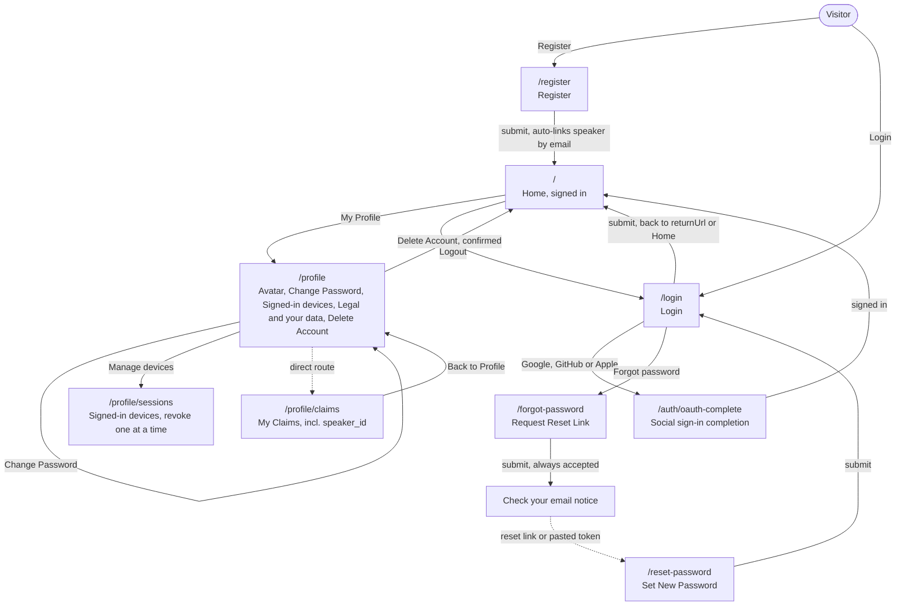

### 5.2 Discover the Schedule (also available anonymously)

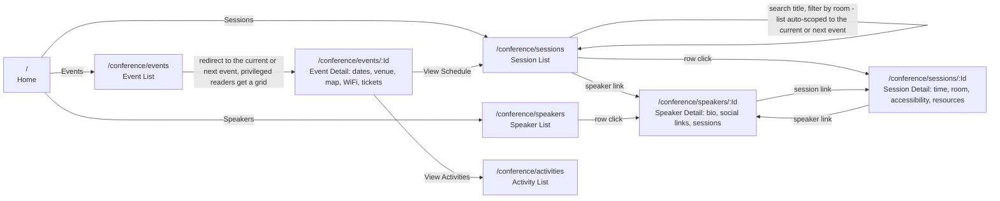

### 5.3 Personal Schedule / Bookmarking

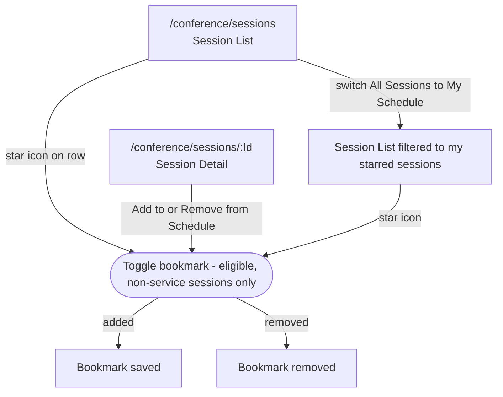

### 5.4 Submit & Manage Feedback

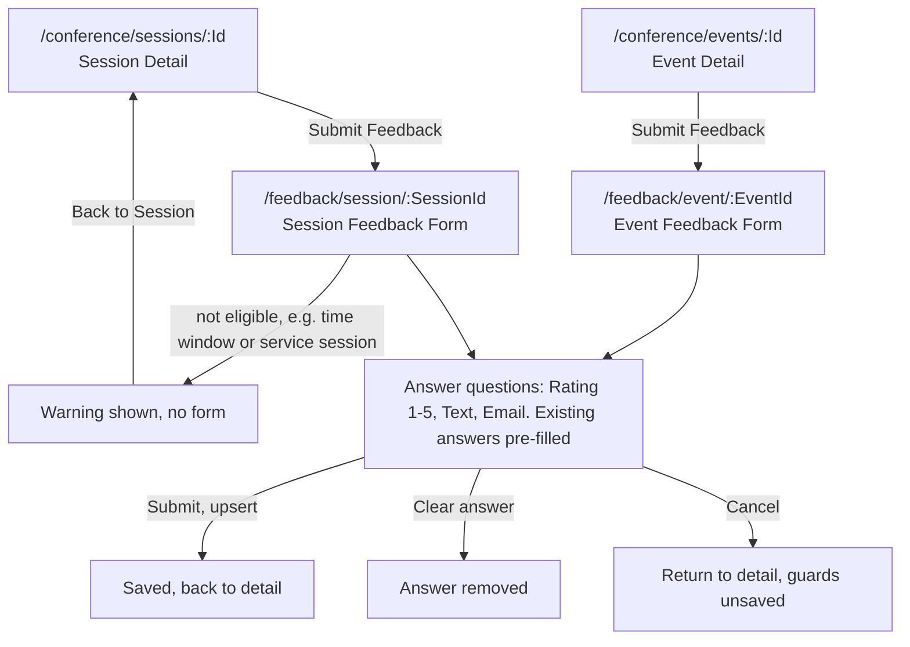

### 5.5 Speaker Dashboard (requires `speaker_id` claim)

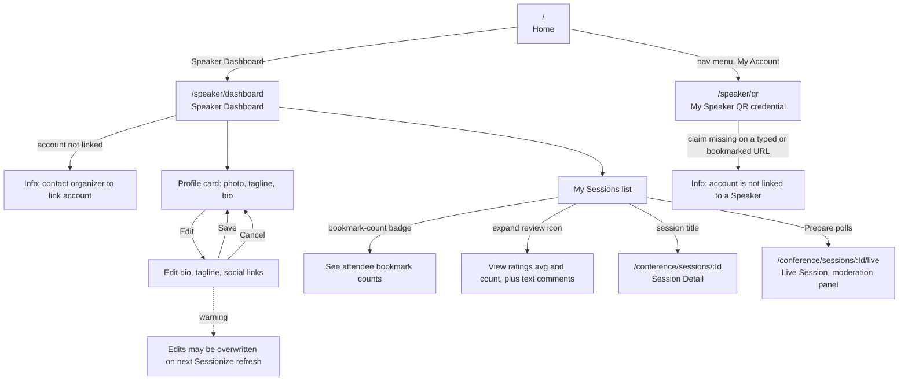

### 5.6 Conference-Day Live Layer (ADR-039)

The live layer is the conference-day surface: it appears for any authenticated user. On the live
session page the moderation panel and the Present button render for an Organizer or for any
account linked to a Speaker (`speaker_id` claim); on Happening Now the Manage tab renders for an
Organizer only. The client renders optimistically and the server is the real authority on who may
moderate a given session (BR-236).

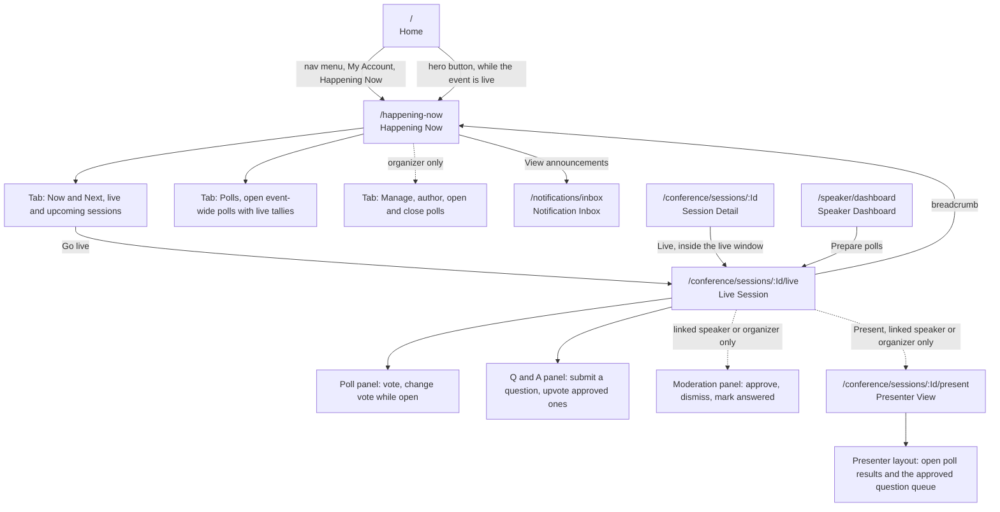

### 5.7 Device Settings (MAUI head only)

`/settings/device` ships **only in the MAUI head** (a host-owned page routed via `DeviceUIModule`),
so it can assume native capabilities exist. It is not reachable from the web heads.

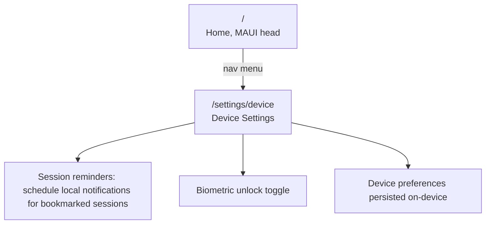

### 5.8 Scanned QR Landings (deep link only)

Two routable pages have no nav item anywhere: an attendee arrives by pointing a phone at a printed
code. Both need authentication only, and both are safe to rescan.

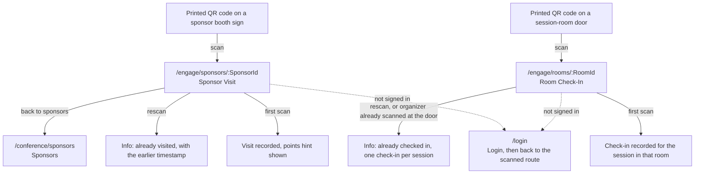

### 5.9 Activities

`/conference/activities` is the public, unauthenticated companion to the Organizer activity CRUD
pages. It lists the activities of the selected event and is the only activity route marked
`[AllowAnonymous]`; the three management routes are Organizer-only.

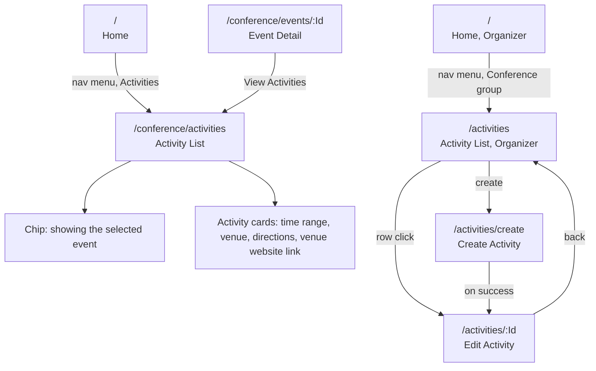

### 5.10 Role Administration (Organizer)

`/roles` lists the three known roles (`Organizer`, `ContentEditor`, `Attendee`, the `KnownRoles` list in the
Identity service configuration) and `/roles/{Role}` is the permission editor for one of them: every capability
the modules register is shown as a checkbox, grants compiled into the role by code render ticked and disabled,
and only the editable grants can be toggled. Both pages carry `[Authorize(Roles = "Organizer")]`, and the
"Roles" nav item is gated on the same `Organizer` role, so the menu never offers a link the page would refuse
(`NavItemGuardContractTests` holds the item and the page guard in step); the `roles:manage` capability
authorizes the writes, not the page. Writes go through the Identity service's `Admin/Roles` endpoints (gateway route
`identity-admin-roles`); the `RoleAdministrationTests` E2E workflow pins the list, the editor and the
disabled compiled grants.

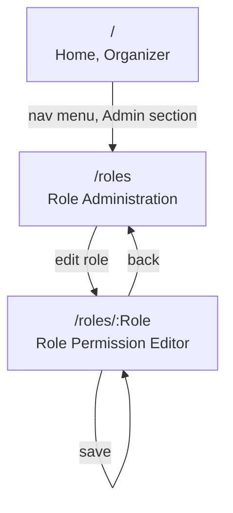

---

## Route Contract

This table lists every routable page ADC itself ships, one row per route, with the access it requires. A CI architecture test in MMCA.ADC compares it with the `@page` routes and their authorization attributes, so a route or guard change lands together with its row here. Framework-owned routes are listed in the Framework-Owned Routes section instead. Every parameterized route is typed (`:int` for the integer-keyed aggregates, `:guid` for speakers, whose identifier is a `Guid`), so a malformed id answers with the not-found page before the page loads; `/roles/{Role}` stays untyped because its parameter is a role name, not an id.

| Route | Page | Access |
|---|---|---|
| `/activities` | ActivityList | Organizer |
| `/activities/create` | ActivityCreate | Organizer |
| `/activities/{Id:int}` | ActivityDetail | Organizer |
| `/check-in` | - | Organizer |
| `/conference/activities` | - | Anonymous |
| `/conference/events` | - | Anonymous |
| `/conference/events/{Id:int}` | - | Anonymous |
| `/conference/sessions` | PublicSessionList | Anonymous |
| `/conference/sessions/{Id:int}` | - | Anonymous |
| `/conference/sessions/{Id:int}/live` | - | Authenticated |
| `/conference/sessions/{Id:int}/present` | - | Authenticated |
| `/conference/speakers` | - | Anonymous |
| `/conference/speakers/{Id:guid}` | - | Anonymous |
| `/conference/sponsors` | - | Anonymous |
| `/conferencecategories` | - | Organizer |
| `/conferencecategories/create` | - | Organizer |
| `/conferencecategories/{Id:int}` | - | Organizer |
| `/engage/rooms/{RoomId:int}` | - | Authenticated |
| `/engage/sponsors/{SponsorId:int}` | - | Authenticated |
| `/events` | EventList | Organizer |
| `/events/create` | - | Organizer |
| `/events/{EventId:int}/feedback` | - | Organizer |
| `/events/{Id:int}` | - | Organizer |
| `/feedback/event/{EventId:int}` | - | Authenticated |
| `/feedback/session/{SessionId:int}` | - | Authenticated |
| `/happening-now` | - | Authenticated |
| `/my-badge` | - | Authenticated |
| `/organizer/attendance` | - | Organizer |
| `/organizer/points` | - | Organizer |
| `/partners` | PartnerList | Organizer |
| `/partners/create` | PartnerCreate | Organizer |
| `/partners/{Id:int}` | PartnerDetail | Organizer |
| `/points` | - | Authenticated |
| `/profile` | - | Authenticated |
| `/profile/claims` | - | Authenticated |
| `/questions` | - | Organizer |
| `/questions/create` | - | Organizer |
| `/questions/{Id:int}` | - | Organizer |
| `/roles` | RoleList | Organizer |
| `/roles/{Role}` | RoleEdit | Organizer |
| `/rooms` | - | Organizer |
| `/rooms/create` | - | Organizer |
| `/rooms/{Id:int}` | - | Organizer |
| `/sessions` | - | Organizer |
| `/sessions/create` | - | Organizer |
| `/sessions/selection-dashboard` | - | Organizer |
| `/sessions/{Id:int}` | - | Organizer |
| `/sessions/{SessionId:int}/feedback` | - | Organizer |
| `/settings/device` | DeviceSettings | Anonymous |
| `/speaker/dashboard` | - | Authenticated |
| `/speaker/qr` | - | Authenticated |
| `/speakers` | - | Organizer |
| `/speakers/create` | - | Organizer |
| `/speakers/{Id:guid}` | SpeakerDetail | Organizer |
| `/sponsors` | - | Organizer |
| `/sponsors/create` | - | Organizer |
| `/sponsors/{Id:int}` | - | Organizer |
| `/users` | UserList | Organizer |
| `/users/{Id:int}` | UserDetail | Organizer |

## Navigation Patterns

### Authentication Redirects
- Unauthenticated users accessing protected pages are redirected to `/login?returnUrl=...` via the `RedirectToLogin` component.
- Successful login returns to that `returnUrl` (sanitized to a local path) or to Home (`/`) when there is none, with a full page reload; a social sign-in completes on `/auth/oauth-complete` and returns the same way. Successful registration redirects to Home with a full page reload.
- Logout (from NavMenu or the MainLayout app bar) redirects to `/login` with a full page reload; the Profile page has no logout of its own, and its Delete Account action signs the user out and returns to Home.
- A signed-in user whose accepted Terms of Service version is behind sees the `TermsAcceptanceGate` (contributed by the Identity UI module as a layout component); declining signs out to `/login`.
- The "Forgot password?" link on `/login` opens `/forgot-password`. The emailed reset link opens `/reset-password` with the email and token in the URL **fragment** (`#`), which the browser never sends to a server, so the single-use token stays out of ingress access logs, request telemetry and the `Referer` header; the page reads them from `location.hash` and scrubs it, and both fields stay editable so a recipient can paste the token by hand instead, and a successful reset returns to `/login`.

### Authorization Model
- **Roles:** three roles, `Organizer`, `ContentEditor` and `Attendee` (the default for new registrations). `Organizer` holds every capability and is the only role that opens the management pages; `ContentEditor` holds the catalog-curation subset of the Organizer's capabilities (API-side permission checks, no extra page routes) and, like the Organizer, is a privileged reader on the public pages: `/conference/events` shows it the full grid (unpublished events included) instead of redirecting, and the public session and speaker lists offer it an event picker; there is no separate "Admin" role. The role-to-capability map is editable at `/roles/{Role}`.
- **Speaker:** not a role, but an attendee whose account is linked to a Speaker, surfaced as the `speaker_id` JWT claim (auto-linked by email match at registration, or linked manually by an organizer).
- **In-page rights, not route rights:** the live layer gates *panels*, not routes. `/conference/sessions/{Id}/live` is one page for everyone authenticated; the moderation panel and the Present button render when the caller is an Organizer or holds the `speaker_id` claim (any linked speaker, not only this session's presenter), and the server re-checks the per-session right on every moderation call (BR-236), so the client-side gate is convenience, not security. On `/happening-now` the Manage tab renders for an Organizer only.
- **Menu-driven visibility:** the left nav is built from each module's `IUIModule.NavItems`. Items declare a required role (`Organizer`), claim (`speaker_id`) or permission (the framework's "Push Notifications" item declares `RequiredPermission: notifications:manage`, read from the `permission` claim the Identity host mints, and ADC grants it to `Organizer`); the menu hides what the current user can't use. Every ADC item that opens an Organizer-only page, "Roles" included, is gated on the `Organizer` role itself, because `NavItemGuardContractTests` requires each item to be no looser than the guard of the page it opens. The conference management items sit in the *Admin* nav section (labelled "Administration") inside the "Conference" group, with "Users" and "Roles" directly in that section; "My Badge", "Check In", "Attendance" and "Points Overview" sit in the general section, gated on the `Organizer` role. "My Profile", "Happening Now", "My Points", the framework's "Notification Inbox", the Speaker "Dashboard" and the speaker's "QR" item sit in the *User* section, rendered under the "My Account" label for signed-in users only. "Activities" appears twice under two different items: a public one pointing at `/conference/activities` with no requirement, and an Organizer one pointing at `/activities` under the "Conference" admin group. The speaker QR item declares `RequiredClaim: "speaker_id"`, so it is hidden from an attendee whose account is not linked to a Speaker; the page itself carries only `[Authorize]` and answers a typed or bookmarked URL with an explanatory alert rather than an empty card.
- **Page guards (`@attribute [Authorize…]`):**
  - *Organizer role required:* `/sessions/selection-dashboard`, `/events/{EventId}/feedback`, `/sessions/{SessionId}/feedback`, and every conference/user management page (`/events`, `/sessions`, `/speakers`, `/conferencecategories`, `/questions`, `/rooms`, `/users`), each carrying a page-level `[Authorize(Roles = "Organizer")]` (e.g. `EventList.razor`, `UserList.razor`). The shared `Routes.razor` renders the Forbidden page for an authenticated non-Organizer; the inherited `RegisteredUser_AdminPages_ShouldBeForbidden` E2E fact pins this for the 13 management routes listed in ADC's `AdminPaths` (the seven above plus `/sponsors`, `/partners`, `/check-in`, `/organizer/attendance`, `/organizer/points` and `/sessions/selection-dashboard`). API-side role enforcement applies as well (defense in depth). The sponsor management pages (`/sponsors`, `/sponsors/create`, `/sponsors/{Id}`), the partner management pages (`/partners`, `/partners/create`, `/partners/{Id}`, each `[Authorize(Roles = "Organizer")]` on `PartnerList.razor`, `PartnerCreate.razor` and `PartnerDetail.razor`), the activity management pages (`/activities`, `/activities/create`, `/activities/{Id}`, each `[Authorize(Roles = "Organizer")]` on `ActivityList.razor`, `ActivityCreate.razor` and `ActivityDetail.razor`) and the check-in and rewards pages (`/check-in`, `/organizer/attendance`, `/organizer/points`) carry the same page-level attribute, and their **writes** are additionally permission-checked API-side (`conference:sponsors:manage`, `conference:partners:manage`, `engagement:checkin:manage`, `engagement:points:view-overview`), so the role opens the page and the permission authorizes the call. The role-administration pages (`/roles`, `/roles/{Role}`, `RoleList.razor` and `RoleEdit.razor`) follow the same shape: `[Authorize(Roles = "Organizer")]` opens the page and the `roles:manage` capability authorizes the `Admin/Roles` writes; `IdentityRouteAuthorizationTests` covers the Identity UI namespace.
  - *Authentication only:* `/profile`, `/profile/claims`, `/speaker/dashboard`, `/speaker/qr`, `/my-badge` (its nav item is Organizer-only, the page is not), `/points`, the two scanned engagement landings (`/engage/sponsors/{SponsorId}`, `/engage/rooms/{RoomId}`), both attendee feedback forms, and the conference-day live pages (`/happening-now`, `/conference/sessions/{Id}/live`, `/conference/sessions/{Id}/present`). `/speakers/{Id}` is not in this list: SpeakerDetail is the Organizer editor reached from the management grids and carries `[Authorize(Roles = "Organizer")]` like the other speaker management pages (pinned by name in `ManagementRouteAuthorizationTests`); a linked speaker edits their own bio on `/speaker/dashboard`.
  - *Public (`[AllowAnonymous]`):* all `/conference/*` read pages including `/conference/activities` (the public activity list, filtered by the selected event), except the two live-layer routes above, plus the two password-reset pages (`/forgot-password`, `/reset-password`), which ship in the framework UI package and are reachable only by an unauthenticated visitor's own action (the "Forgot password?" link on `/login` or the link in the reset email).
  - *MAUI head only:* `/settings/device` is registered by `DeviceUIModule` and exists in no web head.
- **Deep-link-only routes:** `/engage/sponsors/{SponsorId}` and `/engage/rooms/{RoomId}` contribute no nav item and appear in no menu. An attendee reaches them only by scanning a printed QR code (a sponsor booth sign, a session-room door), and both carry a plain `[Authorize]`, so the scan of an unauthenticated visitor lands on `/login` first. Both are idempotent: a rescan reports the existing visit or check-in as information rather than as an error, and an organizer having already scanned the attendee at the door yields the same one check-in.
- **Feature-gated surfaces:** the badge and check-in pages (`/my-badge`, `/check-in`, `/organizer/attendance`) and the points pages (`/points`, `/organizer/points`) call APIs behind the `Engagement.CheckIn` and `Engagement.Points` flags. With a flag off the controller returns **404** rather than 403 (ADR-031) and the page renders empty; the route itself is not removed.
- **One route, two input surfaces:** `/check-in` renders the camera scan card only where the barcode-scanner capability reports itself supported (the MAUI head, [ADR-071](../adr/071-barcode-scanning-and-qr-display.md)). The manual attendee-search panel is always rendered, so on the web and Windows heads that search *is* the check-in surface rather than a degraded fallback. The page adapts; it does not branch on platform.

### Framework-Owned Routes
Some routes come from the `MMCA.Common.UI` package rather than from an ADC module; the web head routes that assembly alongside its own (`MMCA.ADC.UI.Web/Program.cs:329`, `:340`). The two password-reset pages are covered above; the others:
- **`/` (home):** the framework page (`MMCA.Common.UI/Pages/Home.razor:1`). No ADC page declares `@page "/"`, so the Route Contract table leaves it out.
- **`/profile/sessions` (active refresh sessions):** the framework page (`MMCA.Common.UI/Pages/Auth/Sessions.razor:1`) gets its nav link from the framework `NavMenu` (`MMCA.Common.UI/Layout/NavMenu.razor:91-94`), shown only to the role named in `Layout:SessionsNavRequiredRole` (read at `NavMenu.razor:258-259`). ADC sets that to `Organizer` in all three UI hosts (`MMCA.ADC.UI.Web/appsettings.json:36`, `MMCA.ADC.UI.Web.Client/wwwroot/appsettings.json:11`, `MMCA.ADC.UI/appsettings.json:17`), so Attendees, Speakers and ContentEditors see no Sessions link. The setting gates the menu entry only: the page stays reachable for any signed-in account (`NavMenu.razor:86-90`), and every account reaches it from the "Manage devices" button on the Profile page's signed-in devices card (`Profile.razor:98-100`). That split is deliberate. The page lists the caller's own sign-ins and revokes them one device at a time, so it is account self-service that every signed-in account keeps; the menu link is kept to Organizers only to hold the attendee menu to the conference surfaces (ADC commit `48691548`).
- **`/confirm-email` (email confirmation landing):** an anonymous framework page (`MMCA.Common.UI/Pages/Auth/ConfirmEmail.razor:1`, `[AllowAnonymous]` at `:3`, MMCA.Common commit `7d99f9a`), the same page MMCA.Store serves. ADC serves it instead of a copy of its own (ADC commit `379bedba`), and the local AppHost points the confirmation link at it (`MMCA.ADC.AppHost/Program.cs:511-513`). It has no nav item: a visitor reaches it only from the link in the confirmation email.
- **`/auth/oauth-complete` (social sign-in completion):** an anonymous framework page (`MMCA.Common.UI/Pages/Auth/OAuthComplete.razor:1`, `[AllowAnonymous]` at `:12`) that finishes a Google, GitHub or Apple sign-in started from `/login` and returns to the sanitized `returnUrl` or Home (`:94`). It has no nav item.
- **Notification pages:** ADC enables the framework notification UI (`AddNotificationUI()`, `MMCA.ADC.UI.Web/Program.cs:183-184`), so it serves `/notifications/inbox` and `/notifications/inbox/{Id:int}` (any signed-in caller, `NotificationInbox.razor:1-2`, `:7`) with a "Notification Inbox" item in the *User* section, and `/notifications` plus `/notifications/send` (the `notifications:manage` permission, `NotificationList.razor:9`, `NotificationSend.razor:10`) with a "Push Notifications" item in the *Admin* section's "Notifications" group (`NotificationUIModule.cs:19-20`). Happening Now links to the inbox from its "View announcements" button.
- **`/forbidden` and `/not-found`:** anonymous framework pages (`Forbidden.razor:1`, `NotFound.razor:1`); the shared router renders them for an authenticated caller without the page's role and for an unknown or malformed route.
- **`/users/{Id:int}` (user detail):** an ADC page rather than a framework one (`UserDetail.razor:1`, `[Authorize(Roles = "Organizer")]` at `:2`), listed here because the roster it is reached from comes from the framework's shared `UserAdminList` (`UserList.razor:8`). The detail route is typed `{Id:int}` and is reached by a row click on `/users`.

### CRUD Pattern (Organizer)
All admin entity management follows the same navigation pattern:
```
List ──row click──► Detail ──back──► List
 │                    ▲
 └──create──► Create ─┘ (on success)
              │
              └──back──► List
```

### Cross-Entity Links (Organizer)
- **Session List** and **Session Detail** link to Speaker Detail for each assigned speaker.
- **Speaker Detail** links to Session Detail for assigned sessions.
- **Event Detail** and **Session Detail** link to their feedback analytics pages, which link back to the detail page.
- **Session Selection Dashboard** links to Speaker Detail and Session Detail for each analyzed speaker/session.

### Public → Engagement Flow
- **Public Event Detail** and **Public Session Detail** show a "Submit Feedback" button (visible to authenticated users only) that navigates to the corresponding feedback form.
- Feedback forms navigate back to the originating public detail page on cancel.

