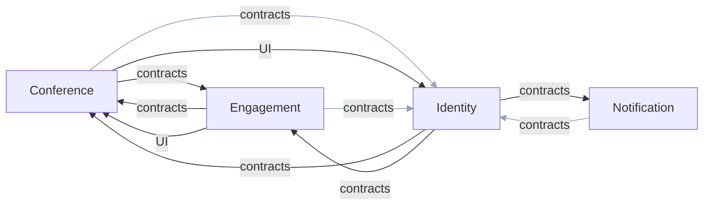
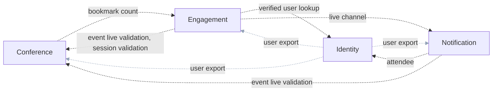
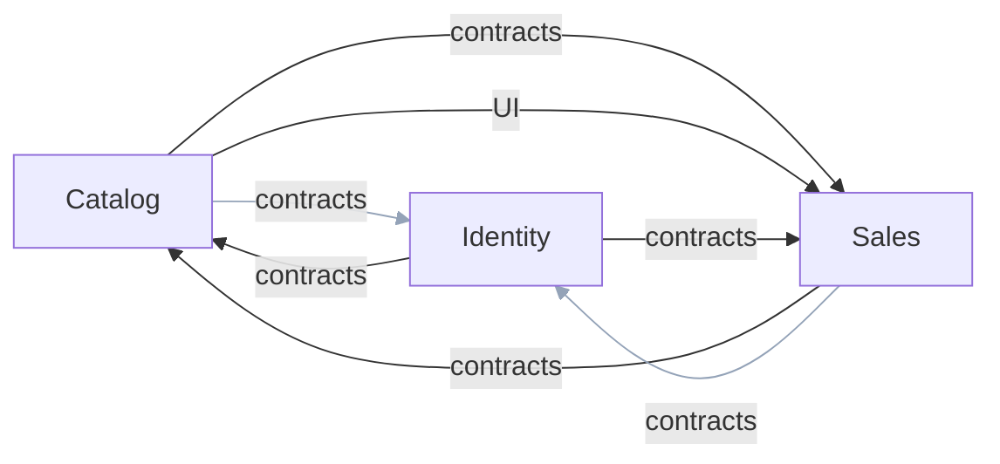
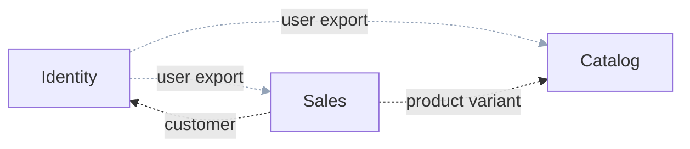

# Module Dependency Graphs

_Generated from the committed project files of MMCA.ADC, MMCA.Store and MMCA.Helpdesk. Do not hand-edit: regenerate it instead._

How the modules of each application depend on one another, drawn as two graphs per application with one arrow per pair of modules:

- **Compile-time references** (solid arrows): a `ProjectReference` from one module's project to another module's project. The label says what the arrow reaches: the peer's `Shared` project (its contracts) or its `UI`. Each repository pins the exact list in its `CrossModuleReferenceTests` (the `CrossModuleReferenceTestsBase` fitness function in MMCA.Common), so adding or removing one is a reviewed change to that test. The table under the graph lists every reference project by project.
- **Runtime calls** (dashed arrows): a service host that references a peer module's `*.Contracts` project wires that peer's gRPC client, so the module calls the peer across the process boundary when the modules run as separate services. The label names the clients the calling service registers. The table says whether the calling module lists the peer in its `IModule.Dependencies`; a "no" is a runtime edge the module loader's ordering and `RequiresDependencies` check do not know about ([ADR-059](../adr/059-module-contract-and-composition.md), Trade-offs).
- **Grey arrows** are the two cross-cutting dependencies. A grey compile-time arrow points into the Identity module's contracts: the user identifier, the role and permission names and the user integration events that every module shares. A grey runtime arrow carries only the data-subject export, in which the Identity module collects each module's part of a user's data. The blue arrows are the module-specific dependencies.

## MMCA.ADC

4 modules: Conference, Engagement, Identity, Notification. 20 compile-time cross-module references, 9 runtime gRPC edges.

### Compile-time references

| From | To |
|---|---|
| `Conference.API` | `Identity.Shared` |
| `Conference.Application` | `Engagement.Shared` |
| `Conference.Application` | `Identity.Shared` |
| `Conference.Shared` | `Identity.Shared` |
| `Conference.UI` | `Engagement.Shared` |
| `Conference.UI` | `Identity.Shared` |
| `Conference.UI` | `Identity.UI` |
| `Engagement.API` | `Identity.Shared` |
| `Engagement.Application` | `Conference.Shared` |
| `Engagement.Application` | `Identity.Shared` |
| `Engagement.Shared` | `Identity.Shared` |
| `Engagement.UI` | `Conference.Shared` |
| `Engagement.UI` | `Conference.UI` |
| `Engagement.UI` | `Identity.Shared` |
| `Identity.Application` | `Conference.Shared` |
| `Identity.Application` | `Engagement.Shared` |
| `Identity.Application` | `Notification.Shared` |
| `Notification.API` | `Identity.Shared` |
| `Notification.Application` | `Identity.Shared` |
| `Notification.Shared` | `Identity.Shared` |

### Runtime calls and declared dependencies

| Calling module | Called module | gRPC clients | In the caller's `Dependencies` |
|---|---|---|---|
| Conference | Engagement | bookmark count | no |
| Engagement | Conference | event live validation, session validation | yes |
| Engagement | Identity | verified user lookup | no |
| Engagement | Notification | live channel | no |
| Identity | Conference | user export | no |
| Identity | Engagement | user export | no |
| Identity | Notification | user export | no |
| Notification | Conference | event live validation | no |
| Notification | Identity | attendee | yes |

Declared `IModule.Dependencies`: Conference (none); Engagement (Conference); Identity (none); Notification (Identity).

## MMCA.Store

3 modules: Catalog, Identity, Sales. 12 compile-time cross-module references, 4 runtime gRPC edges.

### Compile-time references

| From | To |
|---|---|
| `Catalog.Application` | `Identity.Shared` |
| `Catalog.Application` | `Sales.Shared` |
| `Catalog.Shared` | `Identity.Shared` |
| `Catalog.UI` | `Identity.Shared` |
| `Catalog.UI` | `Sales.UI` |
| `Identity.Application` | `Catalog.Shared` |
| `Identity.Application` | `Sales.Shared` |
| `Sales.Application` | `Catalog.Shared` |
| `Sales.Application` | `Identity.Shared` |
| `Sales.Shared` | `Identity.Shared` |
| `Sales.UI` | `Catalog.Shared` |
| `Sales.UI` | `Identity.Shared` |

### Runtime calls and declared dependencies

| Calling module | Called module | gRPC clients | In the caller's `Dependencies` |
|---|---|---|---|
| Identity | Catalog | user export | no |
| Identity | Sales | user export | no |
| Sales | Catalog | product variant | yes |
| Sales | Identity | customer | yes |

Declared `IModule.Dependencies`: Catalog (none); Identity (none); Sales (Catalog, Identity).

## MMCA.Helpdesk

1 module: Tickets. 0 compile-time cross-module references, 0 runtime gRPC edges.

### Compile-time references

None: no module project references another module's project.

### Runtime calls and declared dependencies

None: no service host wires a peer module's gRPC client.

Declared `IModule.Dependencies`: Tickets (none).
