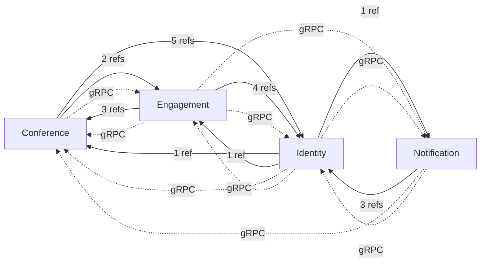
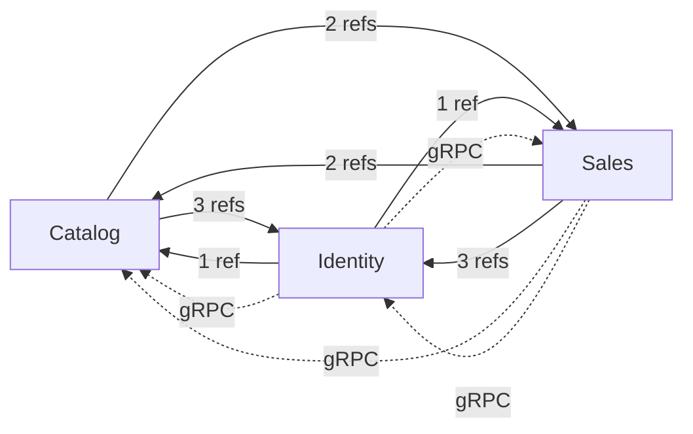

# Module Dependency Graphs

_Generated from the committed project files of MMCA.ADC, MMCA.Store and MMCA.Helpdesk. Do not hand-edit: regenerate it instead._

How the modules of each application depend on one another, at two levels:

- **Compile-time references** (solid arrows): a `ProjectReference` from one module's project to another module's project. Each repository pins this exact list in its `CrossModuleReferenceTests` (the `CrossModuleReferenceTestsBase` fitness function in MMCA.Common), so adding or removing one is a reviewed change to that test. The label counts the project references behind the arrow.
- **Runtime calls** (dashed arrows): a service host that references a peer module's `*.Contracts` project wires that peer's gRPC client, so the module calls the peer across the process boundary when the modules run as separate services. The table beside each graph says whether the calling module lists the peer in its `IModule.Dependencies`; a "no" is a runtime edge the module loader's ordering and `RequiresDependencies` check do not know about ([ADR-059](../adr/059-module-contract-and-composition.md), Trade-offs).

Cross-module references target a peer's `Shared` (contracts) project, except UI composing another module's UI; the IL-level isolation rules ([ADR-059](../adr/059-module-contract-and-composition.md)) and this project-level list together cover the boundary.

## MMCA.ADC

4 modules: Conference, Engagement, Identity, Notification. 20 compile-time cross-module references, 9 runtime gRPC edges.

### Compile-time references

| From | To |
|---|---|
| `Conference.API` | `Identity.Shared` |
| `Conference.Application` | `Engagement.Shared` |
| `Conference.Application` | `Identity.Shared` |
| `Conference.Shared` | `Identity.Shared` |
| `Conference.UI` | `Engagement.Shared` |
| `Conference.UI` | `Identity.Shared` |
| `Conference.UI` | `Identity.UI` |
| `Engagement.API` | `Identity.Shared` |
| `Engagement.Application` | `Conference.Shared` |
| `Engagement.Application` | `Identity.Shared` |
| `Engagement.Shared` | `Identity.Shared` |
| `Engagement.UI` | `Conference.Shared` |
| `Engagement.UI` | `Conference.UI` |
| `Engagement.UI` | `Identity.Shared` |
| `Identity.Application` | `Conference.Shared` |
| `Identity.Application` | `Engagement.Shared` |
| `Identity.Application` | `Notification.Shared` |
| `Notification.API` | `Identity.Shared` |
| `Notification.Application` | `Identity.Shared` |
| `Notification.Shared` | `Identity.Shared` |

### Runtime calls and declared dependencies

| Calling module | Called module | In the caller's `Dependencies` |
|---|---|---|
| Conference | Engagement | no |
| Engagement | Conference | yes |
| Engagement | Identity | no |
| Engagement | Notification | no |
| Identity | Conference | no |
| Identity | Engagement | no |
| Identity | Notification | no |
| Notification | Conference | no |
| Notification | Identity | yes |

Declared `IModule.Dependencies`: Conference (none); Engagement (Conference); Identity (none); Notification (Identity).

## MMCA.Store

3 modules: Catalog, Identity, Sales. 12 compile-time cross-module references, 4 runtime gRPC edges.

### Compile-time references

| From | To |
|---|---|
| `Catalog.Application` | `Identity.Shared` |
| `Catalog.Application` | `Sales.Shared` |
| `Catalog.Shared` | `Identity.Shared` |
| `Catalog.UI` | `Identity.Shared` |
| `Catalog.UI` | `Sales.UI` |
| `Identity.Application` | `Catalog.Shared` |
| `Identity.Application` | `Sales.Shared` |
| `Sales.Application` | `Catalog.Shared` |
| `Sales.Application` | `Identity.Shared` |
| `Sales.Shared` | `Identity.Shared` |
| `Sales.UI` | `Catalog.Shared` |
| `Sales.UI` | `Identity.Shared` |

### Runtime calls and declared dependencies

| Calling module | Called module | In the caller's `Dependencies` |
|---|---|---|
| Identity | Catalog | no |
| Identity | Sales | no |
| Sales | Catalog | yes |
| Sales | Identity | yes |

Declared `IModule.Dependencies`: Catalog (none); Identity (none); Sales (Catalog, Identity).

## MMCA.Helpdesk

1 module: Tickets. 0 compile-time cross-module references, 0 runtime gRPC edges.

### Compile-time references

None: no module project references another module's project.

### Runtime calls and declared dependencies

None: no service host wires a peer module's gRPC client.

Declared `IModule.Dependencies`: Tickets (none).
