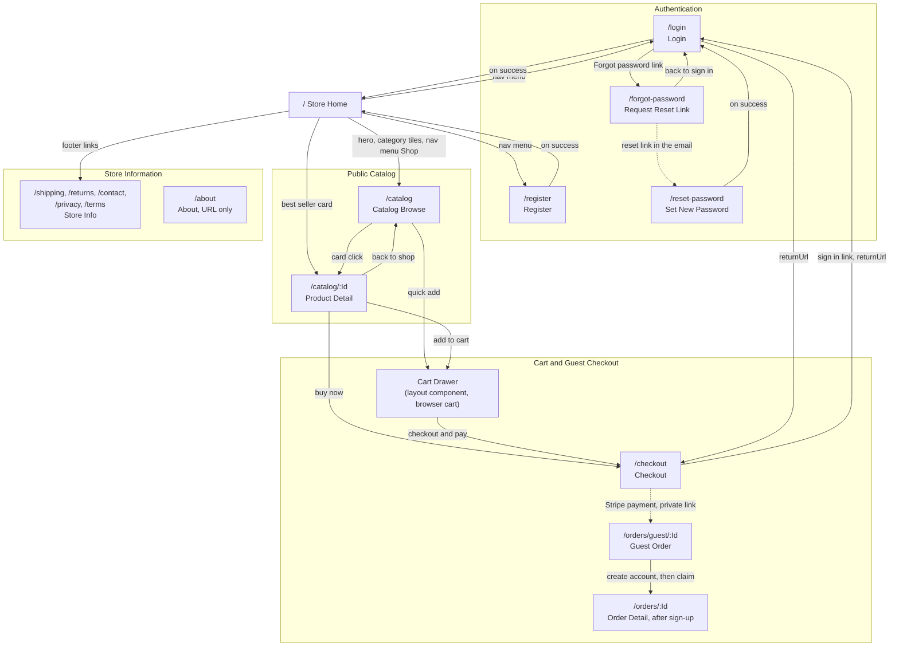
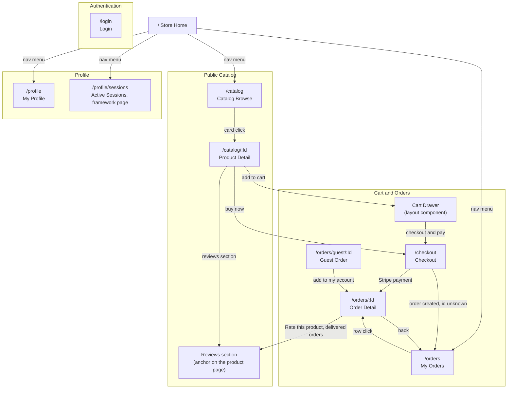

# Navigation Flow

_As of: 2026-10-27 (C.A.S.A Boutique storefront with guest checkout, Store #232 and #233; detail routes typed `{Id:int}`, Store #214)._

This document maps the site navigation flow for each actor in the MMCA.Store application. Each mermaid diagram shows the pages accessible to that actor and the directional navigation links between them. (Companion to MMCA.ADC's `NavigationFlow.md`; same per-actor format.)

## Actors

| Actor | Access Level | Identification |
|---|---|---|
| **Anonymous** | Public storefront: catalog, browser cart, guest checkout and the guest order page, store information pages, auth pages | Not authenticated |
| **Customer** | Anonymous + profile, server cart, own orders | Authenticated, default `Customer` role (`customer_id` claim) |
| **Admin** | Full access: Catalog/Sales/Identity admin CRUD | Authenticated, `Admin` role |

> **Roles and enforcement:** `Admin` is the only elevated role (registration creates a `Customer`). The 19 admin pages carry page-level `[Authorize(Roles = "Admin")]`. The three per-module `*RouteAuthorizationTests` (`MMCA.Store.CI.slnf:40,46,52`) regression-gate all 19 in CI; the Identity test governs `.Pages.Customers`, `.Pages.Roles` and the two user-administration namespaces `.Pages.Users.UserList` and `.Pages.Users.UserDetail` (`IdentityRouteAuthorizationTests.cs:26-32`). Customer-facing data is additionally row-scoped server-side (see **Authorization Model** at the end), so the page gate is defense-in-depth, never the boundary.

---

## 1. Anonymous User

Pages accessible without authentication: home, login, register, the two password-reset pages, the public catalog, checkout, the guest order page, and the store information pages.

> Add-to-cart works signed out. An anonymous shopper's cart lives on the device in the `GuestCartStore` (variant ids and quantities only; `GuestCartStore.cs:6-12`), and `AddItemAsync` writes there for an anonymous shopper (`CartStateService.cs:90-94`). The framework app bar renders the module `CartButton` for authenticated principals only, so the signed-out shopper opens the same drawer through the `GuestCartButton` layout component (`SalesUIModule.cs:33-35`, `GuestCartButton.razor:11-12`). The drawer's "Checkout & Pay" and the product page's "Buy now" both open `/checkout` (`CartDrawer.razor.cs:196-199`, `CatalogProductDetail.razor.cs:197`).

> `/checkout` is `[AllowAnonymous]` (`Checkout.razor:5`): a signed-out shopper either follows the sign-in link to `/login?returnUrl=/checkout` (`Checkout.razor.cs:86`) or continues as a guest with a name and an email, and no account is created (`Checkout.razor.cs:17-24`). A guest order is placed through the API, its private access token is remembered on the device, the browser cart is emptied, and the shopper goes to Stripe; the success and cancel URLs point at `/orders/guest/{Id}?payment=...` with the token in the URL fragment, which the browser never sends to a server (`Checkout.razor.cs:273-317`). If the payment session cannot be opened, the guest lands on the guest order page instead.

> `/orders/guest/{Id:int}` is `[AllowAnonymous]` (`GuestOrderDetail.razor:8`). It reads the token from the fragment, or from the device when the fragment was lost (`GuestOrderDetail.razor.cs:88-99`), and the API answers any other caller with NotFound (`GuestOrdersController.cs:21-27`). A signed-out guest can create an account from the order's own details; the page registers, claims the order into the new account, and full-loads `/orders/{Id}` (`GuestOrderDetail.razor.cs:228-305`). The claim endpoint itself is `[Authorize]` (`GuestOrdersController.cs:125-126`).

> The store information pages are one component with five routes, `[AllowAnonymous]` (`StoreInfo.razor:1-5`, `:11`), linked from the Store footer that renders inside the framework footer on every page (`StoreFooterLinks.razor:13-18`, contributed at `CatalogUIModule.cs:27`). `/about` is `[AllowAnonymous]` too (`About.razor:1`, `:4`), but no Store page, menu or footer links to it, so it is reachable by URL only.

> The product detail page carries a reviews section at the anchor `#reviews`, and the browse cards show a star rating. Both are readable anonymously: the published-reviews endpoint is `AllowAnonymous` and output-cached (`ReviewsController.cs:88-90`). The review editor inside that section appears only for a signed-in viewer: the panel skips the eligibility read for an anonymous one (`ProductReviewsPanel.razor.cs:180-184`).

> `/forgot-password` and `/reset-password` are shipped by the framework UI package and carry `[AllowAnonymous]` (`ForgotPassword.razor:8`, `ResetPassword.razor:12`). The dashed edge is the reset email: the link carries the email and the token in the URL fragment, which the browser never sends to a server, and the page reads and scrubs it from JS (`ResetPassword.razor:124-129`; the query-string form still works for older links). Both fields stay editable so a recipient can paste the token by hand.

---

## 2. Customer (Authenticated User)

Inherits all anonymous pages, including the cart drawer and `/checkout`, where a signed-in customer's server cart becomes the order and the saved profile address pre-fills the form (`Checkout.razor.cs:17-24`). A browser cart from before sign-in moves into the server cart on the first cart load after sign-in (`CartStateService.cs:250-254`). Gains the profile page, the active-sessions page, and their own orders. Unauthenticated visitors deep-linking to `/profile` or `/orders` are redirected to login (SSR session-cookie auth keeps `[Authorize]` enforced on fresh GETs and F5, ADR-022). `/orders/{Id:int}` is the deliberate exception: the page is `[AllowAnonymous]` (`OrderDetail.razor:11`) because the Stripe `?payment=success` return is a full-page load that server-side rendering cannot authenticate, so a page gate would bounce a paying customer to `/login` mid-payment. The protection is API-side: an anonymous read of the order is refused and the page renders only an alert (`OrderDetail.razor:5-10`).

> A signed-in checkout sends the customer to Stripe with `/orders/{Id}?payment=success` as the return (`CartStateService.cs:331-332`). When the Stripe session fails after the order exists, the page lands on the order instead, which offers payment; when the order id is unknown, it lands on `/orders` (`Checkout.razor.cs:244-262`).

> A delivered order's lines carry a "Rate this product" link to that product's reviews anchor, which is the shortest path from "my parcel arrived" to writing the review the delivery entitled the customer to. The editor inside the section still checks eligibility server-side (`GET /Reviews/by-product/{productId}/mine`), so the link is a shortcut, never the authorization.

> `/orders` lists only the caller's own orders (ownership `Specification` row-scoping); an admin on the same route sees all orders. The order detail data is ownership-checked server-side with 404-not-403 semantics so foreign order ids do not leak existence. Abandoned Stripe payments are recovered by the `OrphanOrderRecovery` component on return.

---

## 3. Admin

Inherits all customer pages, plus the admin CRUD surfaces for all three modules and the user and role administration pages. Every page below except the shared `/orders` pair (see the customer section) carries `[Authorize(Roles = "Admin")]`; a customer deep-linking to any of them gets Forbidden on both fresh GET and F5.

```mermaid
flowchart TD
    subgraph CatalogAdmin["Catalog Admin"]
        Categories["/categories<br/>Category List"]
        CategoryCreate["/categories/create<br/>Create Category"]
        CategoryDetail["/categories/:Id<br/>Category Detail"]
        Products["/products<br/>Product List"]
        ProductCreate["/products/create<br/>Create Product"]
        ProductDetailAdm["/products/:Id<br/>Product Detail"]
        ReviewsAdm["/reviews<br/>Review Moderation"]
    end

    subgraph SalesAdmin["Sales Admin"]
        Inventory["/inventory<br/>Inventory List"]
        InventoryCreate["/inventory/create<br/>Create Inventory Item"]
        InventoryDetail["/inventory/:Id<br/>Inventory Detail"]
        Carts["/shoppingcarts<br/>Shopping Cart List"]
        CartDetail["/shoppingcarts/:Id<br/>Shopping Cart Detail"]
        OrdersAll["/orders<br/>All Orders"]
        OrderDetailAdm["/orders/:Id<br/>Order Detail"]
    end

    subgraph IdentityAdmin["Identity Admin"]
        Customers["/customers<br/>Customer List"]
        CustomerCreate["/customers/create<br/>Create Customer"]
        CustomerDetail["/customers/:Id<br/>Customer Detail"]
        Users["/users<br/>User Management"]
        UserDetail["/users/:Id<br/>User Detail"]
        Roles["/roles<br/>Role Administration"]
        RoleEdit["/roles/:Role<br/>Role Permission Editor"]
    end

    Home["/  Store Home"]

    Home -->|nav menu| Categories
    Home -->|nav menu| Products
    Home -->|nav menu| ReviewsAdm
    Home -->|nav menu| Inventory
    Home -->|nav menu| Carts
    Home -->|nav menu| OrdersAll
    Home -->|nav menu| Customers
    Home -->|nav menu| Users
    Home -->|nav menu| Roles

    Categories -->|row click| CategoryDetail
    Categories -->|create| CategoryCreate
    Products -->|row click| ProductDetailAdm
    Products -->|create| ProductCreate
    Inventory -->|row click| InventoryDetail
    Inventory -->|create| InventoryCreate
    Carts -->|row click| CartDetail
    OrdersAll -->|row click| OrderDetailAdm
    Customers -->|row click| CustomerDetail
    Customers -->|create| CustomerCreate
    ReviewsAdm -->|reviewed product| ProductDetailAdm
    Users -->|row click| UserDetail
    Roles -->|edit role| RoleEdit
    RoleEdit -->|back| Roles
```

> The admin order detail page opens `ShipOrderDialog` for both shipment actions: "Ship order" on a Paid order and "Edit tracking" on a Shipped one. One dialog instance serves both, and the summary panel picks the endpoint (`OrderSummaryPanel.razor:195-204`). It is a dialog rather than a route, so it does not appear as a node above. The same page shows the order's shipping label to an admin only (`OrderDetail.razor:88`).

> The admin shopping cart detail page carries a "Checkout" action that checks the customer's cart out on their behalf and stays on the page, reporting the created order in a toast (`ShoppingCartDetail.razor:165-170`, `ShoppingCartDetail.razor.cs:313-329`). It is an action, not a navigation, so it adds no edge above.

> `/reviews` is the moderation grid: every review whatever its status, with hide and unhide. The page carries the Admin route guard, and the endpoints behind it carry the finer-grained `catalog:reviews:moderate` permission (`ReviewModerationController.cs:70`, `:107`, `:129`), which today only the Admin role holds (`CatalogPermissionGrants.cs:29`).

> `/users`, `/users/{Id:int}`, `/roles` and `/roles/{Role}` are Store pages in the Identity UI module whose roster, operator actions and permission editor come from the framework's shared administration components (`UserAdminList` at `UserList.razor:12`, `RoleAdminList` at `RoleList.razor:10`, `RoleAdminEdit` at `RoleEdit.razor:10`; ADR-116). Each carries `[Authorize(Roles = "Admin")]` (`:2` on the two role pages, `:5` on the two user pages). Both the Users and the Roles nav items are gated on the Admin role (`IdentityUIModule.cs:22`, `:28`): the Roles item states exactly the role its page guards on, so the menu never shows a link the page would answer with Forbidden (`IdentityUIModule.cs:24-27`). The endpoints behind the role pages are gated on the `roles:manage` capability by the framework's `RolesAdminControllerBase` (`RoleList.razor.cs:23-24`), which is the check that decides. Store types the detail route as `/users/{Id:int}`, with the `:int` constraint like its other numeric detail routes (`UserDetail.razor:1`).

---

## Route Contract

This table lists every routable page Store itself ships, one row per route, with the access it requires, so a Store architecture test can compare it with the `@page` routes and their authorization attributes and a route or guard change lands together with its row here. Every Store page lives in a module UI project (Catalog, Sales, Identity); the web and MAUI heads declare no `@page` of their own. Framework-owned routes are listed under **Framework-owned routes** in the Authorization Model section instead. The Access column uses exactly three labels, each mapped from the page's `@attribute` line: **Anonymous** is `[Microsoft.AspNetCore.Authorization.AllowAnonymous]`, **Authenticated** is a bare `[Microsoft.AspNetCore.Authorization.Authorize]`, and **Admin** is `[Microsoft.AspNetCore.Authorization.Authorize(Roles = RoleNames.Admin)]`. No Store page uses a policy-based guard or places its guard on the partial class in the `.razor.cs`. `StoreInfo` declares five `@page` routes under one attribute, so it has five rows. Route parameters are written exactly as the `@page` directive declares them; Store's nine numeric detail routes are typed `{Id:int}` and `{Role}` stays an untyped role name, so the table carries the `:int` constraint wherever the directive does.

| Route | Page | Access |
|---|---|---|
| `/about` | About | Anonymous |
| `/catalog` | CatalogBrowse | Anonymous |
| `/catalog/{Id:int}` | CatalogProductDetail | Anonymous |
| `/categories` | CategoryList | Admin |
| `/categories/create` | CategoryCreate | Admin |
| `/categories/{Id:int}` | CategoryDetail | Admin |
| `/checkout` | Checkout | Anonymous |
| `/contact` | StoreInfo | Anonymous |
| `/customers` | CustomerList | Admin |
| `/customers/create` | CustomerCreate | Admin |
| `/customers/{Id:int}` | CustomerDetail | Admin |
| `/inventory` | InventoryItemList | Admin |
| `/inventory/create` | InventoryItemCreate | Admin |
| `/inventory/{Id:int}` | InventoryItemDetail | Admin |
| `/orders` | OrderList | Authenticated |
| `/orders/guest/{Id:int}` | GuestOrderDetail | Anonymous |
| `/orders/{Id:int}` | OrderDetail | Anonymous |
| `/privacy` | StoreInfo | Anonymous |
| `/products` | ProductList | Admin |
| `/products/create` | ProductCreate | Admin |
| `/products/{Id:int}` | ProductDetail | Admin |
| `/profile` | Profile | Authenticated |
| `/returns` | StoreInfo | Anonymous |
| `/reviews` | ReviewList | Admin |
| `/roles` | RoleList | Admin |
| `/roles/{Role}` | RoleEdit | Admin |
| `/shipping` | StoreInfo | Anonymous |
| `/shoppingcarts` | ShoppingCartList | Admin |
| `/shoppingcarts/{Id:int}` | ShoppingCartDetail | Admin |
| `/terms` | StoreInfo | Anonymous |
| `/users` | UserList | Admin |
| `/users/{Id:int}` | UserDetail | Admin |

---

## Authorization Model

Three cooperating layers; the API is always the boundary:

1. **Page-level route guards.** The 19 admin pages carry `[Authorize(Roles = "Admin")]`, `/profile` and `/orders` carry `[Authorize]`, and the eleven storefront routes (`/catalog` and its detail page, `/checkout`, `/orders/guest/{Id:int}`, `/about`, the five store information routes, and `/orders/{Id:int}`) are `[AllowAnonymous]`. `/orders/{Id:int}` is anonymous deliberately (see the customer section; the order API is its gate), and the guest order page likewise defers to the API, where the order's access token is the credential. SSR session-cookie auth (ADR-022, `mmca_auth_access` HttpOnly cookie) lets these attributes pass on fresh GETs, F5, and new tabs, so deep links never render a protected shell to the wrong actor. Regression-gated by `Catalog/Sales/IdentityRouteAuthorizationTests` in CI (commit `c4adff2`) for all 19 admin pages, the `/users` pair included (`IdentityRouteAuthorizationTests.cs:26-32`); `SharedOrderPages_AreNotAdminGated` keeps the shared order pages off the Admin role (`SalesRouteAuthorizationTests.cs:34-47`). The full route-by-route list is the **Route Contract** section above.
2. **API resource ownership (ADR-033).** `OwnerOrAdminFilter` 403s requests whose `customer_id` claim mismatches the owner parameter, and `OwnershipHelper.GetOwnershipSpecification()` row-scopes collection queries so customers only ever receive their own carts/orders. Per-mutation checks on orders return 404-not-403 to avoid leaking existence. Guest orders have no customer: the anonymous guest-order actions take the order's access token in a request header and answer any refusal with NotFound, so they cannot be used to learn which order numbers exist (`GuestOrdersController.cs:21-27`); only the claim into an account requires a signed-in caller (`:125-126`).
3. **In-page conditionals.** `AuthorizeView` and role checks shape the page per actor: the app bar renders the module `CartButton` only for a signed-in principal while `GuestCartButton` serves the signed-out shopper (`NavMenu.razor:46-53`, `GuestCartButton.razor:11-12`), the guest order page offers "add to my account" or "create an account" by sign-in state (`GuestOrderDetail.razor:122-160`), and admin-only affordances (shipment actions, the shipping label, review moderation inside the product page) render only for the Admin role (`OrderDetail.razor.cs:99-104`, `ProductReviewsPanel.razor.cs:108`). These are UX sugar on top of layers 1-2, never the enforcement.

Menu items are rendered per role, so each actor's nav menu contains only the routes shown in their diagram above, plus the framework-owned routes below, which the shared `MMCA.Common.UI` shell contributes to every host. The framework `NavMenu` always renders Home, and filters every module item by its required role (`NavMenu.razor:104`, `:257`); the "Shop" item carries no role, so anonymous visitors see it beside Login and Register (`CatalogUIModule.cs:20`, `NavMenu.razor:94-99`), while the "My Account" and "Administration" sections render only for a signed-in user (`NavMenu.razor:126`, `:153`). The Store footer links (shop and the five store information pages) render on every page for every actor (`StoreFooterLinks.razor:13-18`).

**Framework-owned routes.** These routes come from the `MMCA.Common.UI` and `MMCA.Common.UI.Web` packages rather than from a Store module; the UI host routes those assemblies alongside its own (`UI.Web/Program.cs:286-294`). None of them has a row in the Route Contract table:

- `/` (home) is the framework page (`MMCA.Common.UI/Pages/Home.razor:1`, `[AllowAnonymous]` at `:6`), filled with Store's own content through `IHomePageContent`; no Store page declares `@page "/"`. `/login`, `/register`, `/forgot-password` and `/reset-password` are framework pages too, each `[AllowAnonymous]` (`Pages/Auth/Login.razor:23`, `Register.razor:19`, `ForgotPassword.razor:8`, `ResetPassword.razor:12`), as are the shell's `/not-found` and `/forbidden` pages (`NotFound.razor:7`, `Forbidden.razor:5`) and `/auth/oauth-complete` (`OAuthComplete.razor:12`), which Store never links to because it configures no external sign-in provider. The not-found page shows Store's own content through `IUIModule.NotFoundContentType` (`CatalogUIModule.cs:30`). `/Error` is the shared server-rendered error page from `MMCA.Common.UI.Web` (`Components/Pages/Error.razor:1`, `[AllowAnonymous]` at `:3`).
- `/profile/sessions` (active refresh sessions, `[Authorize]` at `Sessions.razor:5`) is rendered in the nav for every signed-in user, Customer and Admin alike, by the framework `NavMenu` (`MMCA.Common.UI/Layout/NavMenu.razor:87-90`); a host can restrict the link to one role with `Layout:SessionsNavRequiredRole` (read at `NavMenu.razor:252-253`), which Store deliberately leaves unset so customers can review and revoke their own sessions.
- `/confirm-email` is the anonymous email-confirmation landing page (`MMCA.Common.UI/Pages/Auth/ConfirmEmail.razor:1`, `[AllowAnonymous]` at `:3`). Store serves the framework page rather than a copy of its own (Store commit `65b53f5a`), and the Identity service points the confirmation link at it (`ConfirmationUrl`, `Identity.Service/appsettings.json:124`). It has no nav item: a visitor reaches it only from the link in the confirmation email.
- `/notifications`, `/notifications/inbox` (with `/notifications/inbox/{Id:int}`) and `/notifications/send` ship in the same package behind the framework's notification-page policies (`NotificationList.razor:9`, `NotificationInbox.razor:7`, `NotificationSend.razor:10`). Store registers no notification services, so both web heads opt in to `Layout:HideNotificationPagesWhenUnregistered` (`UI.Web/appsettings.json:28-30`, `UI.Web.Client/wwwroot/appsettings.json:28`) and the router answers all four routes with the not-found page and a 404 status (`MMCA.Common.UI/Routes.razor:16-26`, `Notifications/NotificationPageGate.cs:29-31`). They have no nav item and are not a Store surface. The MAUI head does not set the flag (its `appsettings.json` carries only `Modules` and `Api`), so there the pages remain routable by URL behind those policies.
- The installable web app adds no page: `/service-worker.js` is an endpoint mapped by `app.MapCommonServiceWorker()` (`UI.Web/Program.cs:280-281`, ADR-136), its offline fallback is the static `_content/MMCA.Common.UI.Web/offline.html` (`service-worker.js:11`), and the web head's `manifest.webmanifest` starts the installed app at `/`.
